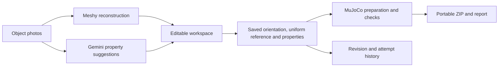

# Kamino

**Turn photos of real objects into editable, portable MuJoCo simulation assets.**

Kamino brings reconstruction, geometry review, physical-property estimates and
simulation export into one workspace. Start with object photos, inspect the
reconstructed mesh, set a real-world reference length, review the assumptions,
and download a runnable bundle. Corrections create new attempts while preserving
earlier inputs and downloads.

[Open Kamino](https://kamino.design) · [Devpost](https://devpost.com/software/kamino) ·
[Figma design](https://www.figma.com/design/rSOvF7zmhYyGwLxGqLRgAo/Untitled?node-id=0-1&m=dev) ·
[Design evidence and access status](docs/FIGMA_EVIDENCE.md)

Built for Cal Hacks 13.0 by Johaan, Atul, Srijan and Yash.
The hosted app uses real reconstruction and estimate services. Creating jobs
requires a team-issued access code because provider usage is metered. The separate
**Use demo photos** experience is synthetic; its demo download is not a validated
MuJoCo bundle.

## What you can do

1. **Upload photos.** We recommend 2–4 clear views of the same object. One image is
   still supported; four is the maximum. Cropping is optional, and originals are retained.
2. **Inspect the reconstruction.** Compare source photos with the actual mesh,
   switch Studio/Mesh display, orbit, pan, zoom and reset the camera. The current
   workspace uses the entire reconstruction for viewing, sizing and export.
3. **Review orientation and size.** Confirm one full-extent reference length in
   the reviewed orientation. Uniform scaling preserves the reconstructed proportions;
   the other dimensions are derived, not independently forced to match estimates.
4. **Review physical properties.** Gemini can suggest properties and explanatory
   notes. Other than the untouched new-job friction default, estimates require
   explicit application. Mass remains editable. Friction starts as **estimated**:
   a valid Gemini estimate can replace the untouched default; otherwise 0.8 is
   disclosed as a simulator fallback with unknown contacting materials. Save commits
   the draft; estimates are not measurements. Optional advanced controls cover
   collision geometry, twist/rolling friction, inertia, contact response and initial
   placement; see [advanced physics and progress](docs/advanced-physics.md) for units
   and validation scope.
5. **Prepare and download.** Generate a MuJoCo scene, local assets, metadata,
   assumptions and validation report. Reopen a saved job, correct its inputs and
   regenerate from cached reconstruction without overwriting earlier exports.

The separate [assembly workbench](https://kamino.design/assembly.html) accepts
component meshes and reviewed link/joint definitions. See the
[guided assembly workflow](docs/GUIDED_ASSEMBLIES.md) and the
[hinge/slider, spring and linked-motion settings](docs/advanced-physics.md#assembly-sliders-springs-and-linked-motion). It does not automatically
infer a robot's articulation from photographs.

## How it works



- **Browser:** TypeScript, Vite and Three.js. The current site lives in
  `prototypes/kamino-ui`; the directory name is historical. Shared viewer/API code
  and the assembly page live in `frontend`.
- **Backend:** FastAPI and Pydantic, with SQLite and local artifact storage.
- **Geometry and simulation:** trimesh, NumPy and MuJoCo.
- **Hosting:** Railway frontend/backend services; `kamino.design` was registered
  through the GoDaddy Registry event offer at Porkbun.
- **Compatibility:** Python imports and environment variables retain the
  `photo2sim` / `PHOTO2SIM_*` names. The public project and repository are Kamino.

## Run locally without provider charges

Requirements: Python 3.12+ with a compatible MuJoCo wheel, Node.js 22.12+ and
pnpm 11.25.0. Keep this environment separate from your robot/LeRobot environment.

```sh
git clone https://github.com/Johaan-Mannanal/kamino.git
cd kamino
python3 -m venv .venv
source .venv/bin/activate
python -m pip install -e '.[dev,simulation]'
pnpm --dir frontend install --frozen-lockfile
pnpm --dir prototypes/kamino-ui install --frozen-lockfile
```

On Windows, create the environment with `py -3.12 -m venv .venv` and use
`.\.venv\Scripts\python.exe` for Python commands (or activate it in your shell).
Intel macOS release checks used Python 3.13 and MuJoCo 3.3.7.

Start the isolated mock API from the repository root:

```sh
python -m tools.run_demo --frontend-port 5188
```

In another terminal:

```sh
pnpm --dir prototypes/kamino-ui dev
```

Open **http://127.0.0.1:5188** and enter the temporary application token printed by
the backend when prompted. This launcher ignores `.env`, uses synthetic reconstruction
and makes no provider calls. Generated server bundles still use real MuJoCo
processing. For the assembly page, run `pnpm --dir frontend dev` and use the
[assembly demo instructions](docs/DEMO.md), including its allowed frontend origin.

For real photos-to-mesh requests, configure backend-only credentials and start the
normal API as described in [environment setup](docs/ENVIRONMENT.md). Real provider
requests can incur charges. Never put provider keys or access codes in frontend
build variables, URLs or Git.

## Verification and release

The deployed advanced-physics baseline is
[`410e88a`](https://github.com/Johaan-Mannanal/kamino/commit/410e88ac6c3e39ec5ab7a176593670d5b5fb7416).
[GitHub CI passed](https://github.com/Johaan-Mannanal/kamino/actions/runs/40202374448).
Frontend follow-ups add sharing previews (`2c9d869`) and correct the stale sizing
notice (`90e45bd`); backend behavior is unchanged. Later documentation commits do
not imply a runtime deployment.

- **492 backend tests passed, 2 optional skips; 143 shared frontend + 160 Workspace
  tests passed.** Both TypeScript checks, production builds and Ruff passed.
- **202 local browser checks** covered desktop/mobile presentation, camera and draft
  behavior, downloads and progress states. Hosted mobile checks also passed.
- Hosted rigid and assembly workflows exercised advanced settings, saving,
  reopening, regeneration and preservation of earlier exports. A relocated rigid
  bundle ran for 10,000 MuJoCo steps with finite state and zero warnings.
- Mobile results use Chromium touch emulation, not full iOS/Android device
  certification. Numerical checks do not establish reconstruction or grasp accuracy.
- These release checks made **no new Meshy or Gemini calls**. Provider reconstruction
  quality and live-service availability remain separate from cached-workflow acceptance.

See the [release and evidence index](docs/RELEASE.md). To run local checks:

```sh
python -m pytest -q
python -m ruff check .
python -m ruff format --check .
pnpm --dir frontend test
pnpm --dir frontend build
pnpm --dir prototypes/kamino-ui test
pnpm --dir prototypes/kamino-ui build
```

## Sponsor work and evidence

| Track / service | What Kamino actually uses | Evidence / qualification |
| --- | --- | --- |
| Google Gemini / MLH — Best Use of Gemini API | Photo-based property suggestions, notes, bounded retries and fallback provenance | [Implementation and sponsor status](docs/SPONSORS.md) |
| Figma — Best Figma Workflow Hack | Design and prototype work informing the implemented UI | [Design link, implementation links and outstanding public evidence](docs/FIGMA_EVIDENCE.md) |
| GoDaddy Registry / MLH — Best Domain Name | The `kamino.design` domain, registered at Porkbun | [Live HTTPS site](https://kamino.design); hosting is Railway |
| Microsoft — Built for the Real World (including second-place Customer Impact Award) | Proposed fit for the robotics asset-preparation workflow | [Eligibility clarification](docs/handoffs/microsoft-real-world-track-assessment.md); sponsor confirmation pending |

These are our four confirmed sponsor pursuits, not claims of eligibility approval
or completed opt-in. Our general award targets are **Cal Hacks Overall
(first/second/third)**, **Most Technically Complex Hack** and **Most Creative Hack**.

No Azure integration is claimed. The inspected Microsoft rules do not specify an
Azure requirement; they do require an AI agent, and the fit of this human-reviewed
workflow remains unconfirmed. Bright Data, Apify, Fetch.ai and Vultr are not current
Kamino integrations or submission claims. Historical research remains in Git.

## Limits to keep in mind

Reconstruction can invent details or distort proportions, including on familiar
objects. Gemini recognizing an object does not constrain Meshy's independent mesh
output. Uniform scaling cannot repair an incorrectly shaped mesh. Because the
whole reconstruction is exported, unwanted reconstructed surroundings also remain.

A numerical physics pass establishes only the checks in its report. Collision
proxies, estimated mass/friction and unverified geometry limit physical fidelity.
SO-101 observation playback is a separate development demonstration; mappings and
physical alignment remain provisional. Illustrative charger carry motion is
scripted. Neither is evidence of validated grasp transfer or a completed
simulation-to-arm execution pipeline.

Optional end-user CAD uploads and automatic parameter-correction proposals are
not part of the released photo workspace. Research/import utilities and historical
examples should not be read as shipped UI features.

[Current project scope](docs/PROJECT.md) · [API](docs/API.md) ·
[Railway deployment](deploy/railway/README.md) · [Examples and provenance](examples/README.md)

## Reuse and attribution

The repository is public, but a project-wide reuse license has not yet been
selected. Third-party robot assets retain their [upstream license](third_party/robotstudio_so101/LICENSE)
and [source attribution](third_party/robotstudio_so101/README.md). See
[publication status](docs/PUBLICATION.md) for outstanding presentation/evidence items.
