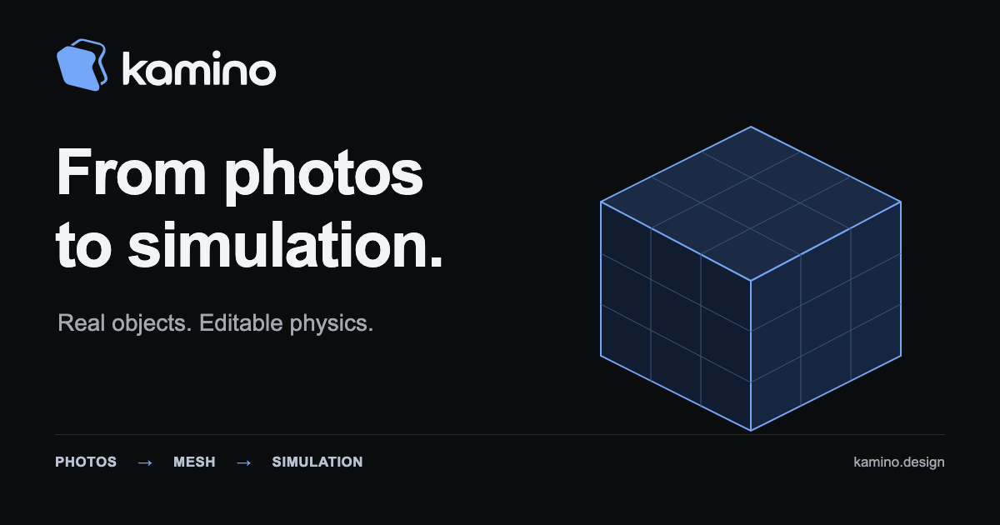
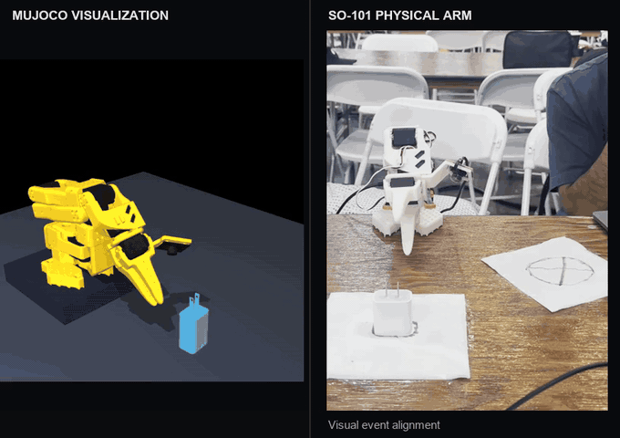
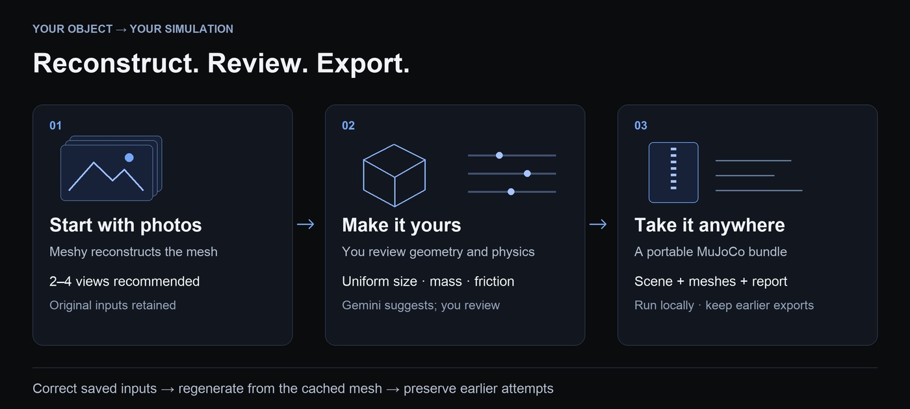

# Kamino

Turn object photos into editable, portable MuJoCo assets. Inspect the mesh, review
its size and physics, then export a runnable scene with earlier versions preserved.
Built for robotics builders, students and engineers at **Cal Hacks 13.0**.

[Explore a complete example](https://kamino.design/example.html) ·
[Open the app](https://kamino.design) · [Run locally](docs/QUICKSTART.md) ·
[Documentation](docs/README.md) · [Devpost](https://devpost.com/software/kamino)

## Demo in motion

**One shared loop, 2× playback.** MuJoCo simulation on the left; physical SO-101
follower-arm execution on the right. Timing is visually aligned
for presentation. [Still frame](docs/images/demo-simulation-and-arm-poster.png) ·
[Sources, crops and timing](docs/images/README.md)

## Try it

- **Run a complete example:** the [synthetic hinged panel](docs/COMPLETE_EXAMPLE.md)
  includes component meshes, reviewed properties, a portable MuJoCo ZIP and
  validation reports. No access code, server or provider calls are needed.
- **Explore the interface:** [Use demo photos](https://kamino.design/#upload)
  opens a procedural mug. Its session-only GLB/property export is not a validated
  MuJoCo bundle; use the complete example above for a runnable simulation.
- **Reconstruct your own object:** [upload photos](https://kamino.design/#upload).
  The public site grants student access automatically, with a shared daily
  allowance because provider usage is metered. Judge and team access use codes. [Access and photo handling](docs/HOSTED_ACCESS.md).
- **Develop locally:** follow the [tested quickstart](docs/QUICKSTART.md), which
  starts with an offline example and uses mock reconstruction for local jobs.

## What you can do

Upload one to four photos (two to four recommended), optionally crop them, and
reconstruct with Meshy. Compare source photos with the entire reconstructed mesh,
review orientation, and use one reference length to scale it uniformly. Gemini
suggests properties with uncertainty notes; estimates stay distinct from measurements.
Review and save mass, friction and other inputs before generating a simulation.

[Advanced physics](docs/advanced-physics.md) exposes collision boxes/hulls, offsets,
sliding/twist/rolling friction, COM/inertia, contact response and placement.
Correct a saved job and regenerate from its cached mesh while retaining earlier
attempts and downloads. Exports include scene XML, local assets, assumptions and
a validation report.

The separate [assembly workbench](https://kamino.design/assembly.html) accepts
component meshes and reviewed links/joints, including hinges, sliders, springs
and linked motion. [Guided workflow](docs/GUIDED_ASSEMBLIES.md).

## Simulation to physical robotics

Kamino connects simulation with physical robotics. We used the SO-101 leader arm to record an initial joint trajectory, brought that motion into MuJoCo, and previewed and adjusted it for the charger demonstration. We then exported the joint motion and executed it on the physical SO-101 follower arm, iterating between simulation and hardware to account for real-world differences. The prototype demonstrates corresponding, working motions side by side, powered by our software. Precise calibration and contact-rich manipulation remain ongoing work.

**Workflow:** leader-arm recording → simulation preview and adjustment → joint-motion export → follower-arm execution → iteration between simulation and hardware.

See [the robotics demonstration](docs/ROBOTICS_DEMO.md) for the workflow and its scope. This prototype is distinct from the controls exposed in the hosted photo workspace.

## Scope and limitations

Reconstruction may distort shape or include unwanted surroundings. Uniform scaling
preserves those errors. Estimated mass/friction, collision proxies and inertia
approximations limit physical fidelity. Numerical checks establish their reported
behavior, not calibrated dynamics or grasp accuracy.

Automatic photo-based part segmentation/joint inference, end-user CAD upload in
the photo workspace and automatic parameter-correction proposals are not shipped.
Browser assembly motion is kinematic; dynamics run in MuJoCo. The hardware prototype
demonstrates trajectory transfer with human iteration; precise calibration and
contact-rich manipulation remain ongoing work.

## Architecture

Photos → Meshy reconstruction + Gemini suggestions → editable review →
MuJoCo preparation/checks → portable ZIP and revision history.

- **Browser:** TypeScript, Vite and Three.js. The current site is in
  `prototypes/kamino-ui`; shared viewer/API code and assembly UI are in `frontend`.
- **Backend:** Python, FastAPI, Pydantic, SQLite and local artifact storage.
- **Geometry/simulation:** trimesh, NumPy, SciPy and MuJoCo.
- **Hosting:** Railway. Python imports and environment variables retain the
  compatible `photo2sim` / `PHOTO2SIM_*` names.

## Development

[Quickstart and supported environment](docs/QUICKSTART.md) ·
[Contributing](CONTRIBUTING.md) · [API](docs/API.md) ·
[Release evidence](docs/RELEASE.md) · [Report an issue](https://github.com/Johaan-Mannanal/kamino/issues)

Software, browser and portable-export checks are documented in the release index.
Physical fidelity is a separate question. Historical reports retain the exact
source, runtime and artifact scope they tested.

## Team, reuse and credits

Built by **Johaan Mannanal, Atul Modur, Srijan Kumbam and Yashwanth Piratla**.
Atul's Figma design/prototype informed the interface.

Kamino’s original code and documentation are licensed under [Apache-2.0](LICENSE).
See [NOTICE](NOTICE), [license scope](docs/LICENSING_OPTIONS.md) and the
[third-party inventory](docs/THIRD_PARTY.md) for attribution and material with separate terms.
Imported SO-101 assets retain their upstream Apache-2.0 license and attribution.

Hardware work builds on [LeRobot](https://github.com/huggingface/lerobot) and
[The Robot Studio](https://github.com/TheRobotStudio/SO-ARM100); the imported
simulation reference comes from [MuJoCo Menagerie](https://github.com/google-deepmind/mujoco_menagerie/tree/f3b6013629c7b94f8ee93fd977b161fa8350f9bc/robotstudio_so101).
It is distinct from photo-reconstructed assets.

[Brand assets](docs/brand-guidelines.md) · [Design evidence](docs/FIGMA_EVIDENCE.md) ·
[Hackathon and sponsor history](docs/SPONSORS.md)
