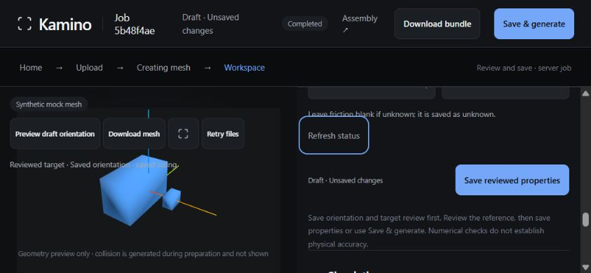
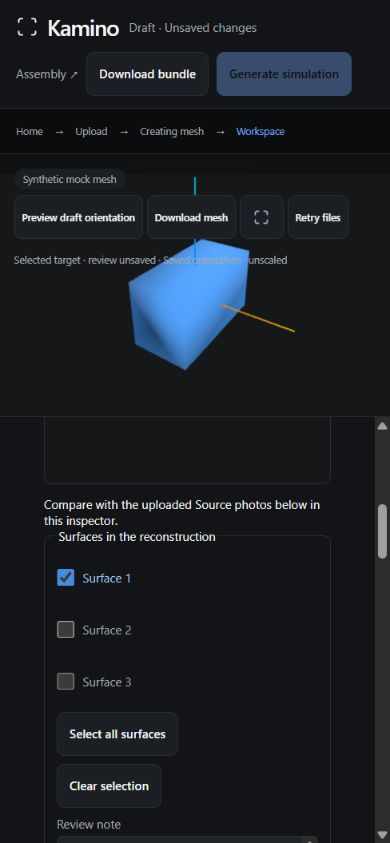
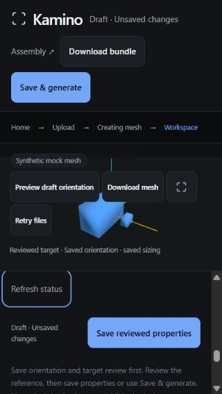

# Mobile fixes against 398ed042

The isolated branch `codex/mobile-current-review` starts at **398ed042a473b1ffeb725667423ba617f16bc3b1**, imported from Master's verified Git bundle. The supplied ZIP SHA-256 was `7652486e9465fd794c55940b46b1f42e02471a8dea6ca50431d5f9abd8c91c44`. Git verified its prerequisite a834763920176f34cafd07a49aa5ea9064bdc545 and the imported branch tip exactly. No cumulative older UI patch was applied.

## Changes and reproductions

- **Toolbar clipping:** the unchanged source reproduced landscape clipping at an observed 844 x 390 CSS viewport. The viewer ended at x424 while the action group ended at x460.07. Live toolbar/actions now wrap within the viewer column, and the status follows them in normal flow. This avoids both clipped controls and a status overlay colliding with wrapped rows. The small-screen viewer's minimum height is 184 px to accommodate these controls; inspector scrolling is retained.
- **Saved-state messages:** target selection, note and acknowledgement drafts previously left both saved indicators saying Saved even though processing was correctly blocked. The indicators now include the existing target draft/status. Returning to a reviewed target after a selection change still requires explicit reference acknowledgement, and now says Reference review required. Loading/stale/unreviewed/error states also avoid claiming the entire workspace is saved. These are display changes; process/save gates are unchanged.
- **Touch access:** live header, viewer and inspector buttons and field shells/selects have a minimum 44 px height on viewports up to 1100 px or with a coarse pointer. The fullscreen button is at least 44 px wide. Surface/acknowledgement labels are at least 44 px tall; checkboxes are 18 px. The source target-review controls and their semantics are unchanged.

Changes are limited to the prototype's style.css, saved indicator rendering in live-workspace.ts, three DOM regressions in live-workspace.test.ts and this handoff evidence. Backend/API/access/session/usage, backend-session.ts, target-review.ts, source selection/context binding, friction provenance/defaults and the processing workflow remain unchanged. Cosmetic spacing, a broad scrolling redesign, detailed warning presentation and the mesh-quality investigation were deferred.

## Checks

From `prototypes/kamino-ui`:

```sh
node node_modules/vitest/vitest.mjs run --configLoader native --reporter=verbose
node node_modules/typescript/bin/tsc --noEmit
node node_modules/vite/bin/vite.js build --configLoader native
```

Workspace suite: **125 passed, 0 skipped, 8 files**. This includes existing cache/automatic estimate, access/session, save-before-generate, target-review/race, retained draft and download regressions. Before the implementation change, all three new cases failed on Saved versus Draft; the other 35 workspace-file cases passed. The test checks were then adjusted to preserve the existing rule that selection changes clear acknowledgement, whereas note-only changes retain the reference binding.

TypeScript and production build passed. The existing >500 kB JavaScript chunk warning remains. `git diff --check` passed. A full Python suite, deployment/container build and real provider calls were not run for this UI-only change. Existing ignored pinned dependencies were reused; this is not a fresh-install acceptance run.

Runtime: Windows 11, Node 24.22.1, Python 3.12.4 simulation environment, Vite 7.3.7, TypeScript 5.9.3, Vitest 3.2.7 and Three.js 0.180.0.

## Focused browser verification

**Desktop in-app browser emulation with mouse/keyboard**, not a real phone or touch certification. Observed CSS viewports: **320 x 568, 390 x 844, 430 x 932, 844 x 390**. Browser engine version was not exposed by the available controls. No iOS/Android keyboard, pinch/multitouch, screen-reader, safe-area or real-device performance verification is claimed.

The exact branch UI used a loopback API at port 8009 and UI at 5194. The API was initialized explicitly with empty provider keys and outgoing network blocked; no .env was read. A copy of the earlier synthetic three-box job and its two completed attempts was used, with a seeded null-value offline Gemini cache. No new reconstruction, Gemini request, save or generation was submitted. The initial local sign-in was rejected because the test harness had omitted port 5194 from allowed origins; the harness was corrected explicitly. The application's origin guard was preserved.

At all four sizes, measured key controls were at least 44 px high, checkbox rows were at least 44 px high, the toolbar stayed within its viewer and did not overlap the status, Save was reachable by ordinary focus navigation in the inspector, and a valid local draft enabled Save and Save & generate. Assertions checked child control bounds, rather than relying only on document scrollWidth.

The browser confirmed the target-only case separately, without editing numbers: unchecking Surface 2 changed both indicators to Draft / Unsaved changes, cleared target/reference acknowledgements and disabled generation. Mass 0.13 and reference 100 remained. Restoring selection and explicitly acknowledging the target left Reference review required; explicitly acknowledging the reference enabled Save and Save & generate with the same numeric values. Clicking the enlarged Surface 2 label toggled its checkbox normally.

Attempts (2), warnings and earlier bundle controls remained reachable. Downloading the existing bundle with an unsaved 0.131 mass draft preserved that draft. Download SHA-256 **bed858a69c5e0aabaea76121d1094a4b1f74cdd262063464060fb45cdfa97f9c** matched the original attempt B exactly; all 11 ZIP entries passed CRC verification. No simulation/physical-accuracy claim is made by this download check.







The source/evidence identities and commands are recorded here. Detailed DOM measurements, fixture scripts and complete test/build/access logs are retained in the separate mobile-398ed04 evidence archive. The scripts use host-local paths and a public offline fixture token; neither real credentials nor private photos are included.

## Original report and transfer

The original a834763 report is unchanged at **b81faf1f10081c186f12e19bc52cca6954864da1**, pushed on `codex/mobile-a834763-review`. Its unchanged archive was uploaded to `codex/mobile-a834763-evidence` at **ec68f05263747738aefd141620e3f3c153691a9b**. Downloading the actual archive back from that exact GitHub commit reproduced SHA-256 **5819dce3f4a4290e6a38e4fd3451355bffb3ccdcb8009e1cef6e4d6b06ff30fb**. Master can retrieve it without a Windows path:

[Original evidence ZIP](https://raw.githubusercontent.com/Johaan-Mannanal/kamino/ec68f05263747738aefd141620e3f3c153691a9b/docs/handoffs/mobile-evidence/kamino-mobile-a834763-20261025.zip)

These fixes are isolated for review. No deployed ref was changed. The next integration check should apply this branch's incremental delta to Master's accepted source, preserving subsequent access, sizing, mesh-quality and friction work, followed by a real-phone interaction check when a device is available.
