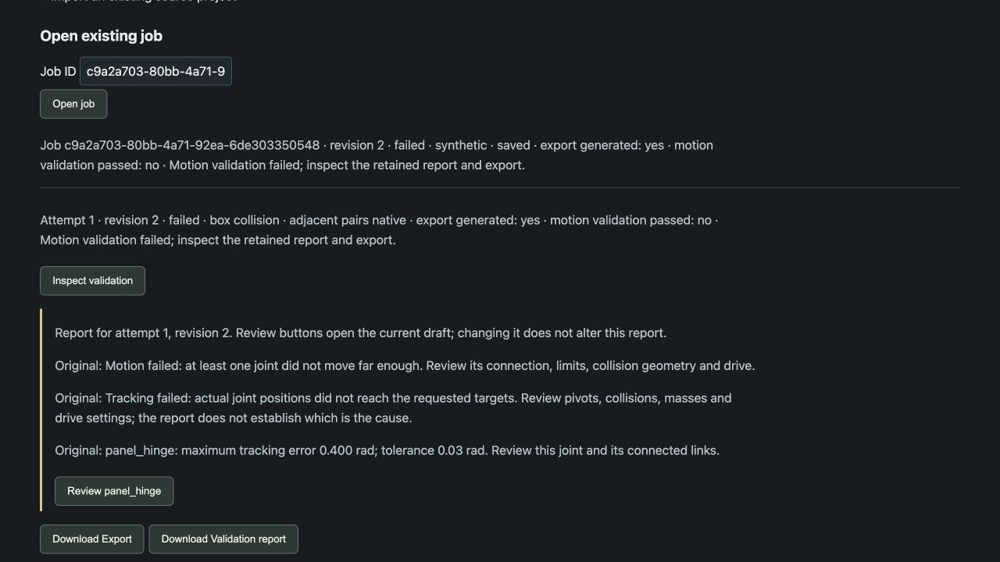
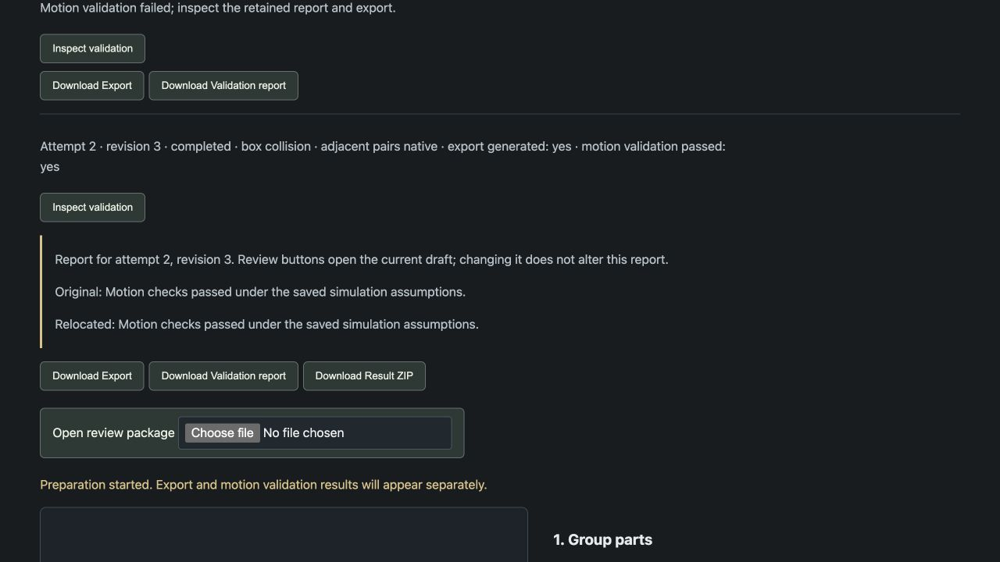

# Synthetic hinged panel — guided entry and correction

A fixed post and rotating panel demonstrate the generic assembly workflow beyond
SO101. Both inputs are generated boxes, **not reconstructed photographs**.
Geometry, mass, damping and drive parameters are engineering assumptions.

The live browser acceptance used `input/post.obj` and `input/panel.obj` directly,
without uploading or hand-authoring a project JSON. The UI created the draft,
links and joint, saved revisions, ran real MuJoCo checks and downloaded the ZIP.

## Reproduce

Start the [local demo](../../../docs/DEMO.md), then open `/assembly.html`.

1. Set name `hinged_panel`, units **millimetres**, and **Synthetic fixture**.
   Upload `post.obj` first and `panel.obj` second; create the draft.
2. Add link `panel`, parent `base`, joint `panel_hinge`, type revolute.
   Assign the panel mesh to `panel`; retain the post mesh in `base`.
3. Set the panel link pivot to `(0.02, 0, 0.18)` metres. Rename `base` to `post`.
   The post is 20 × 20 × 200 mm, centered at `(0,0,150)` mm; the panel is
   120 × 8 × 120 mm, centered at `(80,0,180)` mm. Parts share this reference frame.
4. Review the estimated 0.1 kg mass for each link. Leave friction unknown.
   Use hinge axis `(0,0,1)`, limits `[-0.8,0.8]` rad, damping `0.2` Nm s/rad,
   and torque limit `2` Nm. For the deliberate failure, set gain to `0.000001`
   Nm/rad. Add a review note to each link/joint, Apply, then acknowledge all three.
5. Save the revision and process with box collision and native adjacent-pair policy.
   **Inspect validation** reports the hinge's ~0.400 rad error against 0.03 rad.
6. Click **Review panel_hinge**, change gain to `5` Nm/rad, update its review note,
   Apply, re-acknowledge all records, save a new revision and process again.
7. Inspect the passing original/relocated report and download **Result ZIP**.
   The failed attempt remains available. Downloading does not require regeneration.

Input order controls generated part IDs; use filenames/provenance notes to identify
parts if your file chooser changes the order. Whole-scene placement and link pivots
are separate concepts. This fixture's post is fixed above the world origin; it does
not model a physically measured mount.

## Captured result

- Job `c9a2a703-80bb-4a71-92ea-6de303350548`, failed revision 2, corrected revision 3.
- Failure maximum tracking error: `0.400000004765334` rad.
- Corrected maximum tracking error: `9.99e-16` rad; unchanged tolerance `0.03` rad.
- Each run: two reset trials with three 2-second target phases; timestep `0.001` s.
- Corrected original and relocated checks passed; browser-downloaded ZIP matched
  the server bytes. Independent extraction outside the job directory and another
  relocation also passed. No browser console warnings/errors were captured.
- Python 3.13.7, MuJoCo 3.3.7, NumPy 2.5.4 on Intel macOS. Native viewer and Windows
  acceptance of this new fixture have not been performed.

[Portable ZIP](simulation.zip) includes scene, report, assumptions, prepared review,
normalized source meshes and original millimetre inputs. [Acceptance metadata](evidence/browser-acceptance.json)
records its hash. [Failed report](evidence/attempt-0001-validation.json),
[corrected report](evidence/attempt-0002-validation.json),
[download revalidation](evidence/download-validation.json) and the two saved
revision JSONs preserve the correction evidence.

Passing these checks establishes behavior under the saved assumptions, not
physical accuracy, camera reconstruction quality, or robot calibration.
