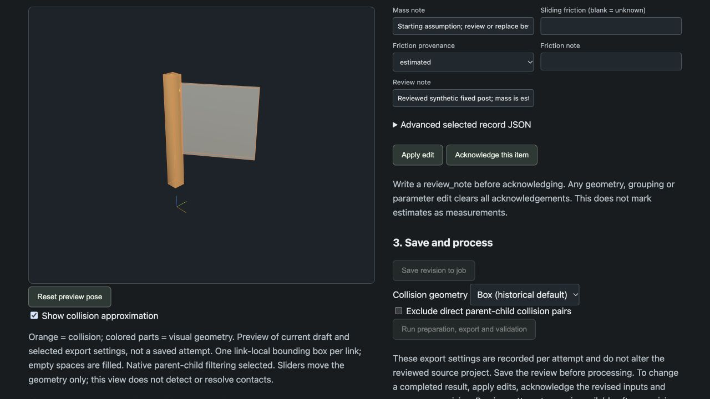
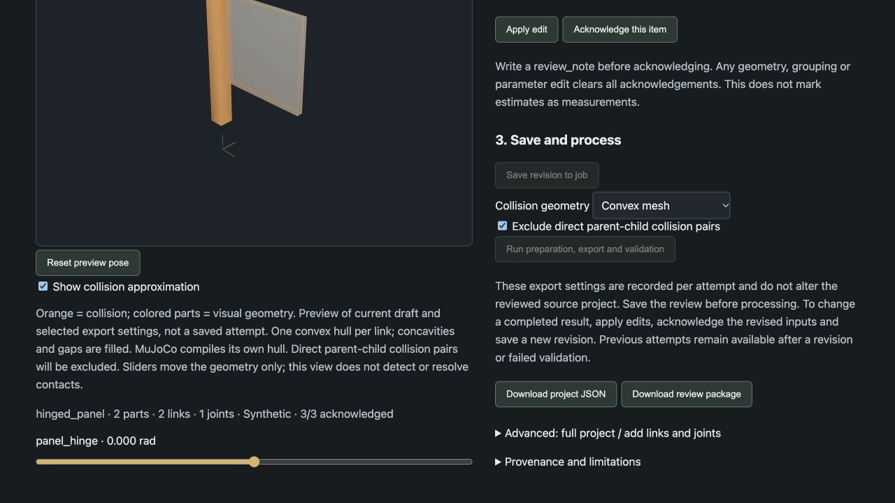

# Portable export and collision preview acceptance

This is a new export of the [synthetic hinged panel](../hinged-panel/README.md),
using the generic workbench. It is not a photo reconstruction or physical test.

## Browser evidence

Loaded the existing persistent job, enabled the orange collision overlay, moved
the hinge to 0.6 rad, switched box → convex, selected direct parent-child exclusion,
and reset to zero. The proxies followed the parts and reset. Review remained 3/3
acknowledged until an input review note was edited. The caption identifies the
current draft and export policy; it does not claim contact solving.

A new saved revision 4 produced attempt 3 with convex collision and excluded
adjacent pairs. Original and relocated motion checks passed. Authenticated browser
ZIP download matched the server bytes. No browser warning/error logs were captured.
The historical box-mode attempts remain intact.

## Export usable without Photo2Sim

[Downloaded ZIP](simulation.zip), SHA-256
`3dec136689b4ff9fc7c4e1ed05a534ba7dc4ac791850fb630dbe366b462b3e20`
(13,272 bytes), includes a README, assumptions summary, environment metadata,
MuJoCo version pin and standalone runner in addition to the existing artifacts.
[Assumptions copy](ASSUMPTIONS.md) retains estimated masses and unknown friction.

The browser download was extracted outside the repository. A new Python 3.13.7
virtual environment installed only `mujoco==3.3.7` and its dependencies; an import
probe confirmed Photo2Sim was absent. From another working directory, the runner
completed approximately three simulated seconds with finite state and zero MuJoCo
warnings. [Standalone report and package versions](evidence/standalone-run.json).
The runner's zero-control smoke check is distinct from the [pipeline motion report](evidence/validation.json).

The standalone native GUI was not manually exercised in this acceptance. A
MuJoCo scene-update probe verified that the native convex-hull display flag changes
collision geoms while retaining the visual mesh when both layers are enabled.
Windows acceptance of this new runner remains pending; platform instructions and
the exporting environment are included in the ZIP.

Automated geometry tests also cover grouped/excluded parts, rotated link frames,
a non-convex arrangement where a 9-unit box encloses a 7-unit convex hull, and
joint-frame motion. The preview uses Three.js hull construction; MuJoCo compiles
its own hull and remains authoritative for exported contacts.
