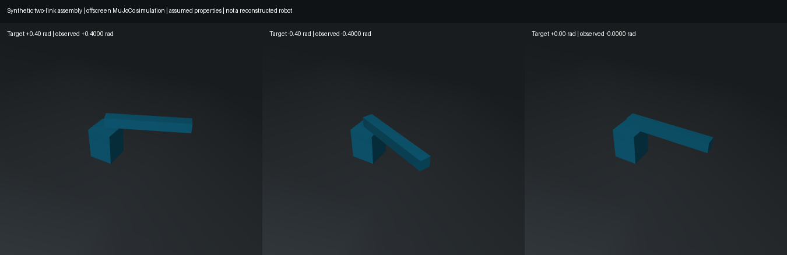

# Generated two-link, one-hinge proof

**This is synthetic engineering geometry, not a photo reconstruction or an SO101
model.** It proves that reviewed parts/joints can pass through reusable Photo2Sim
contracts and produce a portable, controllable MuJoCo assembly. No SO101 model
files, dimensions or joint names are used by the conversion modules.

## Inputs and outputs
- [Reviewed input record](input/assembly.json): two rigid links and a revolute
  joint with explicit local frames, limits, mass and drive assumptions.
- `input/meshes/base.obj`: centred 60 × 60 × 80 mm box, assumed 0.5 kg.
- `input/meshes/arm.obj`: 200 × 25 × 25 mm box, centre at local X=100 mm;
  assumed 0.1 kg. This offset is preserved, not automatically recentered.
- Joint: local Z axis, limits ±0.8 rad, position gain 5, torque cap ±2 Nm,
  damping 0.2 Nm·s/rad. All are explicit synthetic assumptions.
- Fixed base at world (0,0,0.25) m, hinge at base-local (0,0,0.06) m. The base
  is fixed above the ground for an isolated articulation test, not a mounted-arm
  physical scene. Full gravity is enabled; this vertical-axis hinge has no gravity
  torque about its axis. Passing it does not validate gravity compensation.
- [Generated bundle](bundle/scene.xml), reviewed metadata, simulator assumptions,
  copied meshes and [validation report](bundle/validation.json). A
  [second validation](validation-reviewed-record.json) also checks the compiled
  model against the reviewed record and exported mesh hashes.

Generated using the public CLI below. Boxes were created with trimesh's box
primitive at the stated sizes; only the arm was translated 100 mm along X.

## Verified on Johaan's Mac
Python 3.13.7, MuJoCo 3.3.7, NumPy 2.5.4, trimesh 5.2.0.

Original and relocated bundle each pass two identical six-second trials. Each
trial commands +0.4, -0.4, then 0 rad for two seconds each, at a 1 ms timestep
(12,000 steps total per location). Actual joint motion, final target tracking,
joint limits and reset repeatability pass, with zero MuJoCo/Python warnings.
Maximum phase-end tracking error was 7.22e-16 rad for this easy synthetic fixture;
this is numerical controller agreement, not real-world accuracy. The fixed
tracking tolerance is 0.03 rad, and observed excursion must reach at least half
of the commanded excursion so an unmoving joint cannot pass.



The image is an offscreen MuJoCo render after actual integration to each target.
It is separate from native-viewer acceptance, which is pending on Windows.

## Reproduce in the existing simulation environment
From the repository root, use a new output directory on each export:

```sh
python -m photo2sim.assemblies export examples/assemblies/two-link-hinge/input/assembly.json --output-dir outputs/assemblies/hinge-run-1
python -m photo2sim.assemblies validate outputs/assemblies/hinge-run-1/scene.xml --report outputs/assemblies/hinge-run-1-recheck.json
python -m mujoco.viewer --mjcf outputs/assemblies/hinge-run-1/scene.xml
```

On Windows PowerShell, replace `python` with
`& .\.venv-sim\Scripts\python.exe`. The export command runs original/relocated
validation and writes `validation.json`. A failed check returns exit code 1 and
keeps the generated bundle/report for inspection; export/load failures never
publish a partial bundle. Existing output directories/reports are not overwritten.

In the native viewer, show the Control panel, change `drive_hinge` to +0.4,
-0.4 and 0 radians, and observe the moving link. Use the viewer's Reset control
(or Backspace) and confirm the zero reference. Keep geometry group 2 visible and
hide group 3 for the visual mesh; switch groups to inspect box collisions.
Copy the **whole bundle directory** elsewhere and repeat, not just scene.xml.

Optional offscreen evidence (requires working graphics services):

```sh
python tools/assemblies/render_example.py outputs/assemblies/hinge-run-1/scene.xml --output outputs/assemblies/hinge-run-1.png
```

## Limits and next step
This is a CLI/library milestone. The web UI and rigid job API do not yet accept
assemblies. It requires prepared per-link meshes and reviewed joints; no automatic
CAD grouping, segmentation or joint inference is claimed. The first version uses
box collisions and uniform-box inertia, and fixes the root to the world.
Adjacent-link collisions follow MuJoCo's default filtering. Motion checks do not
certify collision fidelity or all configurations. See [assembly format](../../../docs/ASSEMBLIES.md).

Next: guided part grouping/joint review, then apply those inputs to the SO101 and
compare independent physical reference poses. Keep the imported robot reference
separate from generated outputs.

## Regression verification

52 focused assembly tests pass, including invalid graphs/paths, rotated frames,
branched trees, disabled drives, altered scene parameters, same-bounds replacement
meshes, bundle re-export and CLI failure preservation. Full suite: 259 passed,
1 optional ACP dependency skip; one existing Starlette/httpx deprecation warning.
Lint, formatting and dependency checks pass. Independent review found a mesh
identity validation gap; its regression failed before the fix and passes now.
