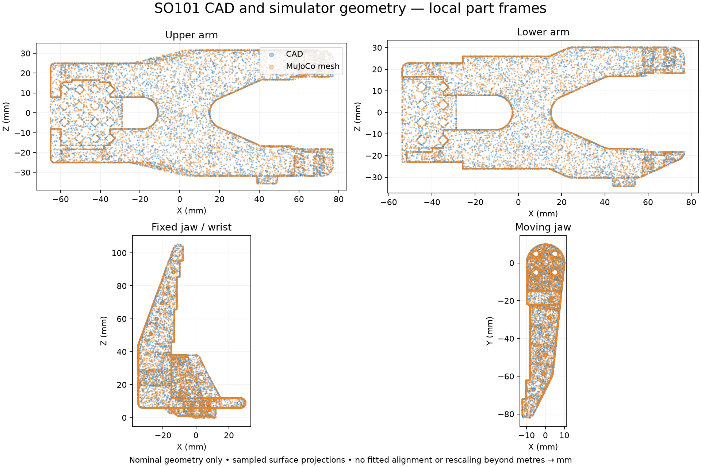

# SO101 nominal CAD comparison — 2026-10-24

**Keep the pinned robot geometry.** Eleven major CAD components closely match
its meshes; no broad link-size correction is indicated. This comparison does
not establish hardware joint zeros/signs, gripper calibration, or physical layout.

## Source and method

- CAD: Yash's unchanged [reference ZIP](../windows/cad/so101-assembly-reference.zip),
  imported from `codex/windows-simulation-setup` commit
  `e6ab5589dc3d6bd8c9b80379abaed0bfc1109a81`. See its historical
  [handoff](../windows/cad/README.md) for provenance limitations.
- Extracted `SO101 Assembly.step`: SHA-256
  `f754be35708382b05ce65768ae33c612f91dca11ad19d14807dc637eb944ba3d`.
- Model: unchanged Menagerie SO101 at
  `f3b6013629c7b94f8ee93fd977b161fa8350f9bc`; every vendored source hash verified.
- OpenCASCADE imported the STEP assembly, preserving component placements and
  duplicate component names. CadQuery's higher-level assembly importer rejected
  a duplicate name, so the script traverses the STEPCAF/XCAF document directly.
- All **215 geometry representation contexts use millimetres**. The separate
  metre unit declaration occurs in derived properties; it does not require
  rescaling individual geometry components. Imported 270 leaves, including 11
  empty wiring-holder reference leaves.
- Comparisons retain original local part coordinates. Only the simulator STL
  units are converted from metres to millimetres. No fitted alignment, shape
  deformation, or fitted scaling was used.
- Analytic CAD bounding boxes are compared with STL bounds. Surface distances
  use 2,000 area-weighted points in each direction with fixed seeds. These are
  sampled distances, not an exhaustive Hausdorff bound or measured accuracy.

## Findings

All 11 compared parts have bounding dimensions within **0.006 mm** of the model
meshes. Selected CAD bounding dimensions, in each part's local XYZ axes:

| Component | Nominal CAD bounding dimensions, mm |
| --- | --- |
| Base | 110.925 × 72 × 87 |
| Upper arm | 142.170 × 24.5 × 67.3 |
| Lower arm | 130.700 × 24 × 64.4 |
| Fixed jaw / wrist | 65.2 × 52 × 105.425 |
| Moving jaw | 22.3 × 92 × 48 |

These are component bounding dimensions, **not joint-centre link lengths**.
The full eleven-part comparison, volumes, versions and methods are in
[report.json](report.json).

Most sampled surfaces closely agree. Localized differences remain: the wrist
pitch component has approximately 0.018 mm at the larger directional 95th
percentile, but a largest sampled difference of **1.57 mm**. The base's largest
sampled difference is about 0.30 mm. Matching bounding boxes alone does not prove
identical surfaces, contact geometry, mass distribution, or dynamics.



The saved CAD assembly's driven servo-horn axes are slightly tilted: instances
2–3 differ by **0.500°**, and instances 3–4 by **0.707°**. These are extracted from
cylindrical horn geometry with accumulated assembly transforms; see
[servo-axes.json](servo-axes.json). The model's corresponding shoulder-lift,
elbow and wrist-flex axes are parallel in its zero pose. Do not replace model
joint frames or infer physical calibration from this saved CAD pose. Cylinder
origins are points along axes, not necessarily joint centres, so their direct
point-to-point distances are not accepted link-length measurements.

No camera assembly was confidently matched to the model's camera mount, PCB
and lens. The actual wrist bracket/camera still needs separate comparison.
CAD solid volumes do not establish real component mass or inertia.

## What remains for the live comparison

1. Yash finishes combined-scene viewer and reset acceptance.
2. Match synchronized whole-arm reference images with observed joint values;
   verify each joint's sign/zero and the gripper conversion.
3. Measure base-to-table placement and object position/orientation. CAD cannot
   supply the current physical mounting or table coordinates.
4. Compare observation replay first, then a short agreed action with actual
   sent/clipped targets and timing preserved.

No model meshes, joint frames, gains, limits or collision settings were changed.
No physical robot commands were issued. Charger dimensions/mass remain estimated.

## Reproduce

Run from the repository root in a **separate** environment. The recorded run used
Python 3.13.7 on Intel macOS; this optional CAD tool is not an application or
LeRobot dependency. Package versions are in [environment.txt](environment.txt).
Choose new output directories on repeat runs.

```sh
python3.13 -m venv /tmp/photo2sim-cad
/tmp/photo2sim-cad/bin/python -m pip install -r tools/so101/requirements-cad.txt
/tmp/photo2sim-cad/bin/python -m pip check
/tmp/photo2sim-cad/bin/python -m zipfile -e examples/so101/windows/cad/so101-assembly-reference.zip outputs/so101/cad-source
/tmp/photo2sim-cad/bin/python tools/so101/inspect_cad.py --step 'outputs/so101/cad-source/SO101 Assembly.step' --output-dir outputs/so101/cad-review-new
/tmp/photo2sim-cad/bin/python tools/so101/plot_cad_comparison.py --inspection-dir outputs/so101/cad-review-new --output outputs/so101/cad-review-new/comparison.png
```

The standalone inspection script was rerun against the original STEP; all 11
comparison records reproduced exactly. Optional environment `pip check`, script
lint/format checks and source hash checks passed. Application tests were not
repeated because application/model behavior did not change.
