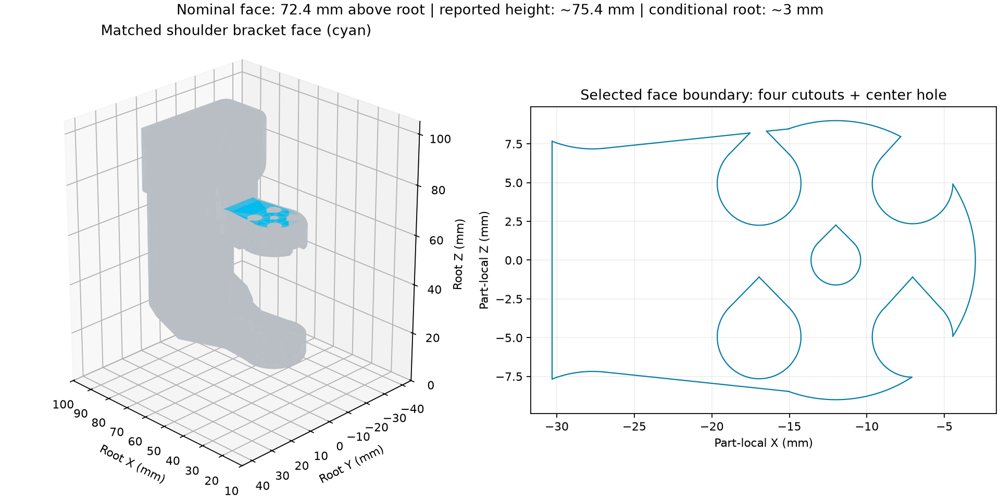

# Shoulder reference face and provisional mounting height

**The indicated face is nominally 72.4 mm above the model root.** The approximate
75.4 mm measured tabletop-to-face height therefore implies **root Z approximately
3 mm above the tabletop**, conditional on level mounting and correct transfer of
the measuring-aid reading to that face. It is not a complete mounting calibration.



## Evidence and correspondence

The original [CAD screenshot and measurement follow-up](../../windows/reference-20261024-take3/measurement-followup/README.md)
are copied byte-for-byte from Windows commit
`1ca9a52a0f0b0311c4fcfe9e229b7d3f8821eef0`. The black bar is a removed measuring
aid and is excluded from the robot model. The physical clamp is a separate item.

The screenshot matches the upper rounded mounting tab of **Rotation_Pitch_SO101
v8**, belonging to the model's **shoulder** link. Matching features are the
component silhouette, planar tab, four off-center fastener cutouts and central
hole. No source face identifier was supplied; this is an engineering visual
identification cross-checked against the actual CAD geometry.

For the pinned STEP hash recorded in `report.json`, the imported face is index
37 (zero-based). Its repeatable geometric selector is:

- Local plane **Y = 56.4 mm**, normal +Y.
- Area approximately **317.69808 mm²**.
- Four cutout centers around X = -16.94975 / -7.05025 mm and Z = ±4.94975 mm;
  central hole at X = -12 mm, Z = 0, radius 1.6 mm.

The original STEP uses millimetres, as established in the earlier
[representation-context audit](../../cad-review/README.md). We use its local part
coordinates with the existing reference-template transforms. The saved STEP's
assembly pose is not treated as physical calibration.

## Calculation and independent checks

The reference model places the shoulder origin at Z = 62.4 mm relative to root.
The part transform and shoulder rotation give:

```text
face height above root = 62.4 - 46.4 + 56.4 = 72.4 mm
operator reading      = 2.97 inches × 25.4 = 75.438 mm
conditional root Z    = 75.438 - 72.4 = 3.038 mm ≈ 3 mm
```

This assumes model root Z aligns with the tabletop normal. Rotation about the
vertical shoulder-pan axis preserves the face height. Other arm joints are
downstream and do not move this face. XY position, yaw, base tilt and camera
extrinsics remain unknown. The aid-to-face transfer offset and measurement
uncertainty were not supplied; **3.038 mm is arithmetic precision, not measured
accuracy**. The reference measurement is approximate and CAD is nominal.

The interior face anchor matches the actual API-exported shoulder mesh to floating
point precision, and its plane normal matches. Sampled analytic boundary vertices
differ from the tessellated export by up to **0.0889 mm**, with 95th percentile
**0.0122 mm**; this is not an exhaustive surface-distance bound. An initial 0.05 mm
boundary assertion failed. Inspection located the discrepancy at curved hole
edges (the CAD export tessellates at 0.08 mm / 0.1 rad); the interior anchor and
normal were then checked separately. The boundary discrepancy is retained in the
report rather than treated as exact geometry agreement.

An independent MuJoCo 3.3.7 forward-kinematics check confirms the **72.4 mm**
offset in the actual API scene at shoulder-pan angles 0, take-3's baseline,
-1 and +1 rad. See `export-fk-check.json`. No simulation time was advanced.

**No root placement was applied to the accepted export.** It still uses its
explicit 0.15 m free-space test clearance. Changing to a tabletop setup requires
a separate scene revision and fresh contact/motion checks; its prior free-space
acceptance cannot be carried over automatically. No joint mapping, gains, limits,
hardware calibration or source geometry was changed.

## Other follow-up incorporated

- Both original take-3 photos are operator-confirmed rear-camera, unflipped.
  Our earlier mirroring suspicion is superseded; no photo pixels were altered.
- The later approximately 3.18 mm jaw gap followed shoulder repositioning with
  uncertain jaw continuity. It remains unpaired and is not used to calibrate
  take-3 gripper observations.
- The original API ZIP's Windows acceptance is reported at `1ca9a52`. Its SHA-256
  in the Windows summary matches the accepted archive. No repeat acceptance is
  requested for that unchanged ZIP.

## Reproduce

Use the existing separate CAD environment from `tools/so101/requirements-cad.txt`.
Extract the pinned STEP and API bundle into new local output directories, then:

```sh
python tools/so101/match_mounting_reference.py \
  --step 'outputs/so101/cad-inspection/SO101 Assembly.step' \
  --bundle-dir outputs/so101-api-extracted \
  --output-dir outputs/so101-mounting-new
```

The script verifies source identity, selects the face, matches the exported mesh
anchor/normal and shoulder transform, and saves the report and figure. Use a new
output directory. No robot access or provider calls are involved.
