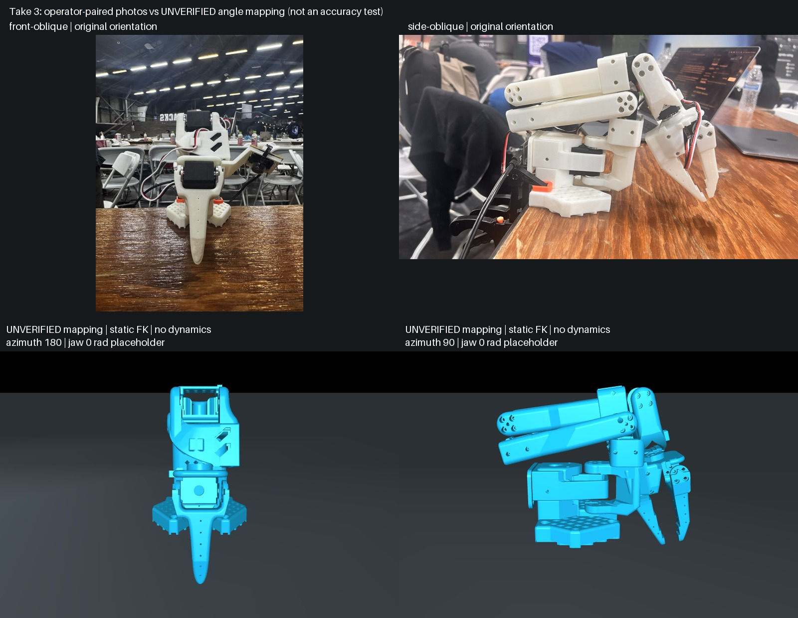

# Take 3: stationary photos versus an explicit mapping hypothesis

The direct-angle baseline reproduces the broad folded posture seen in the paired
front/side photographs. It is a useful qualitative comparison, **not verified
joint calibration, physical accuracy, or a passing motion test**.



## Source and association

- Windows source commit: `d07d713c3cb57f1316bd0950fc48ba71f4478f9d`.
- [Original take-3 capture](../../windows/reference-20261024-take3/): all 11 files
  imported byte-for-byte, including original photographs and `pairing.json`.
- 599 observations spanning 119.8436 seconds; every signal's observed span is zero.
  This establishes recorded encoder stability, not independent physical stationarity.
- Photo association is operator-confirmed stationary capture, not hardware
  synchronization. Exact photo times remain unavailable. The immutable original
  `capture.json` predates pairing; `pairing.json` supplies the later association.
- Model is the actual saved-job [SO101 API export](../../../assemblies/so101-guided/api-workflow/README.md),
  SHA-256 `aff9c1a3a7690e8cafcae30eaa37ce5b33c82d7b46621dc51741fd05311344b0`.
  CAD/template-assisted structural geometry; not reconstructed from these photos.

## Mapping used only for the displayed baseline

No signs, offsets, dimensions, or camera calibration were fitted to the images.
For the five arm joints: `q = radians(observed median)` with assumed positive sign
and zero offset. The gripper's normalized value is **not converted to an angle**;
zero radians is a display-only placeholder.

| Joint | Observed median | Unit | Baseline angle (rad) |
|---|---:|---|---:|
| shoulder_pan | -0.395604 | degrees | -0.006905 |
| shoulder_lift | -104.175824 | degrees | -1.818211 |
| elbow_flex | 96.175824 | degrees | 1.678585 |
| wrist_flex | 84.043956 | degrees | 1.466844 |
| wrist_roll | 4.175824 | degrees | 0.072882 |
| gripper | 0.954980 | normalized 0–100 | unknown; display placeholder 0 |

**Concrete discrepancy:** the shoulder-lift baseline is 4.175821 degrees below
the exported model's approximately -100-degree lower limit. Do not hide this by
clamping observations or widening the model limits. The calibration convention,
zero offset and limit provenance need review. A sign flip alone cannot resolve
this magnitude exceeding the symmetric model range.

This script sets `qpos` and calls `mj_forward` only. It deliberately retains the
out-of-range angle for diagnostic visualization and performs **zero dynamics
steps**. This pose is not a valid control target or a dynamics acceptance result.

## Visual findings and limits

- Side view: the folded upper/lower links and downward gripper broadly resemble
  the real arm. Front view: the stacked wrist/gripper silhouette is also plausible.
  These qualitative observations do not establish per-joint accuracy.
- The real images are oblique; render cameras are illustrative cardinal views
  at -12 degrees elevation. No pixel alignment, camera intrinsics, extrinsics,
  3D endpoint error or numeric physical-accuracy score is claimed.
- Follow-up at Windows commit `1ca9a52` confirms both originals used the rear
  camera and were not flipped horizontally. This supersedes our earlier visual
  suspicion about background lettering; the images remain unchanged. Camera
  intrinsics/extrinsics are still unknown. The comparison only resizes originals
  proportionally.
- The zero-radian jaw looks broadly near-closed, but jaw opening is unmeasured.
  `render-4.png` and `render-5.png` show the model's two gripper range endpoints
  solely as an uncertainty illustration, not alternate measured poses.
- The later approximately 3.18 mm jaw-gap measurement followed shoulder
  repositioning; jaw continuity is unknown. It is not a take-3 calibration point.
- The accepted model retains its assumed 0.15 m free-space base height. The real
  base is mounted at the table; these renders cannot establish mounting alignment.
- The CAD subset omits servos, camera/mount, wiring and clamps visible in photos.
  Missing appearance and mass distribution must remain explicit in the demo.

## Reproduce offline

From the repository root with the simulation dependencies and Pillow installed:

```sh
python tools/so101/compare_take3.py --output-dir outputs/so101-take3-new
```

Choose a new output directory. macOS requires access to the graphics session for
MuJoCo rendering. The script verifies capture/calibration and photo hashes,
extracts the reviewed API fixture locally, preserves out-of-range readings, and
saves four cardinal views, two jaw endpoint cases, the comparison and a report.
No robot connection, service keys, network calls, or hardware commands are used.
Presentation changes are limited to framebuffer size, lighting and camera.

Artifacts: `report.json` records the exact mapping hypothesis, model ranges,
source identities and camera settings; `all-views.jpg` shows all four baseline
views. `capture-audit.json` is the existing generic integrity audit; its unverified
pairing flags describe what that audit alone can establish. The separately hashed
pairing record and `report.json` explicitly record operator association.

Executed with Python 3.13.7 / MuJoCo 3.3.7. Windows rendering and mapping review
remain separate acceptance steps. No source model, calibration, exported archive,
joint limits or existing validation thresholds were changed.

## Next evidence needed

Yash should investigate the shoulder offset/limit discrepancy
and obtain additional operator-associated poses to disambiguate signs
and zeros. Measure jaw opening and base/table reference. One stationary pose
cannot identify both sign and offset for each joint. Only after mapping review
should observation replay and then commanded-motion prediction be compared.
