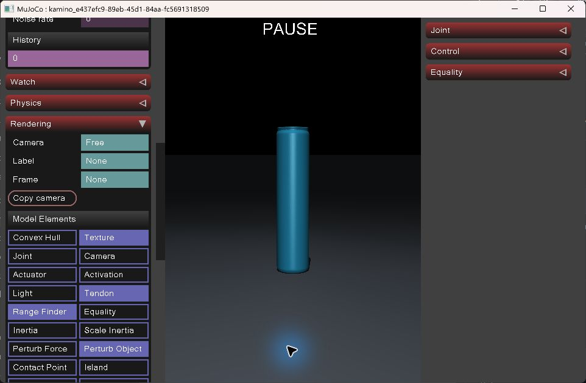
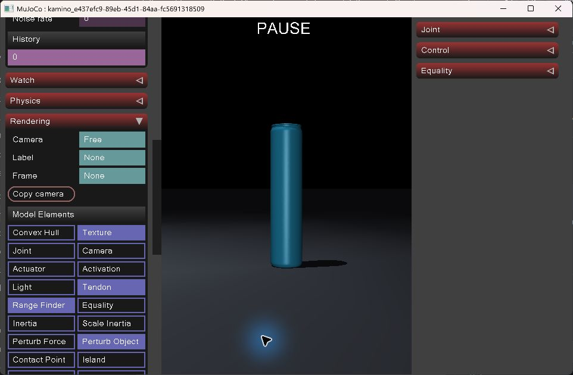
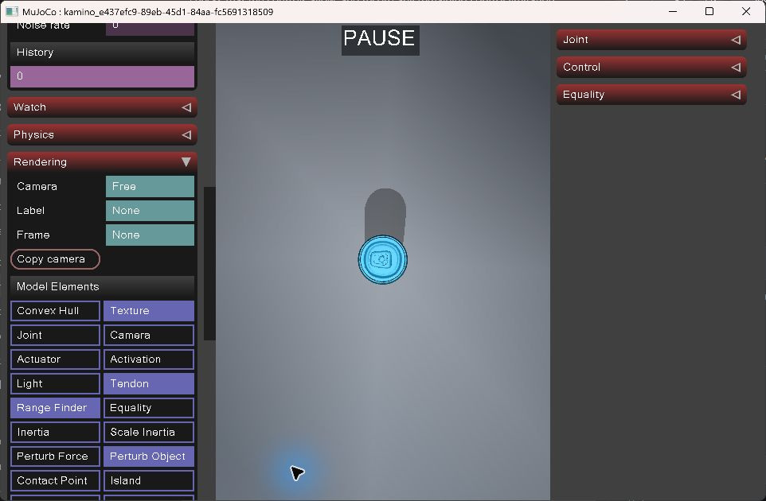
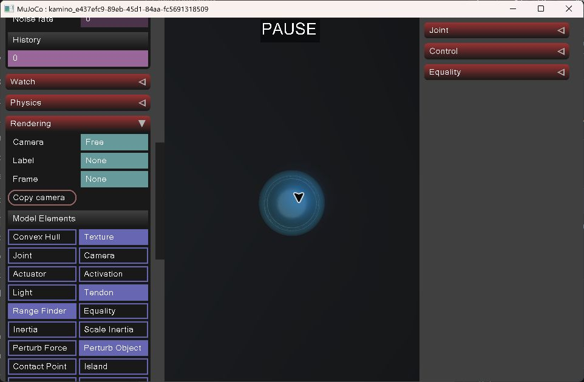
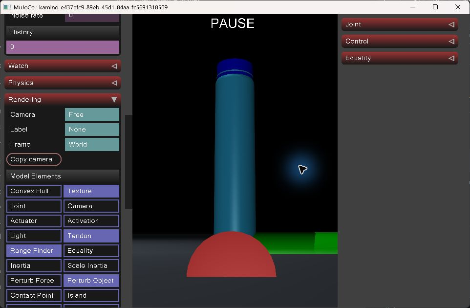
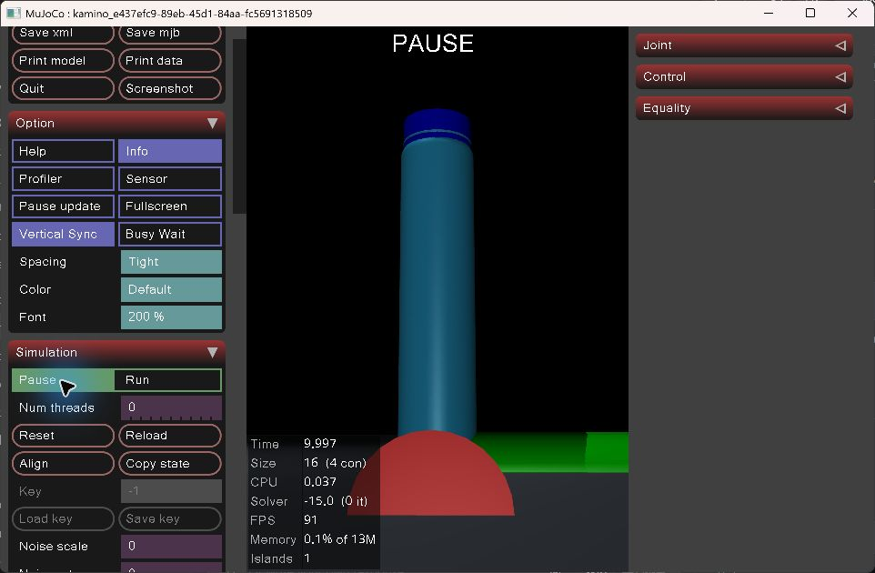
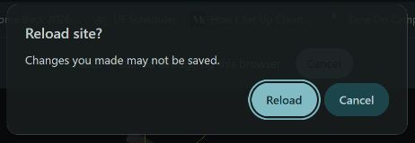
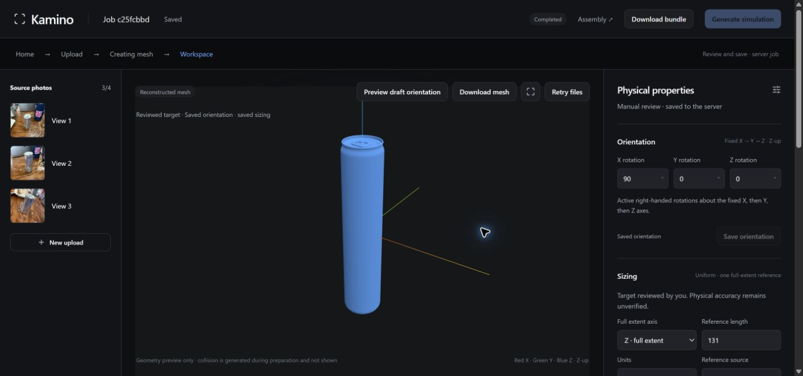

# October 25 manual acceptance addendum

**S02, O01, Z03 and D03: PASS.** Combined position: **24 PASS / 4 BLOCKED**. The original record stays 20 PASS / 8 BLOCKED and is preserved byte-identically. Release acceptance remains blocked; physical/grasp accuracy remains unverified.

Read [ADDENDUM.md](ADDENDUM.md) for observations, human participation, tooling caveats and preservation evidence, or [the handoff for Johaan](../../../../docs/handoffs/windows-acceptance-manual-addendum-20261025.md).

Download and extract [the evidence ZIP](2026-10-25-manual-followup-evidence.zip), then verify [its checksum](2026-10-25-manual-followup-evidence.zip.sha256). It contains only new dated follow-up evidence; the original 52 MB archive is not rebuilt or duplicated. The adjacent manifest and summary are readable copies from the ZIP. Evidence paths in ADDENDUM.md are relative to the extracted archive root.

Actual human-operated camera views of the unchanged final B scene:

| Front | Side |
| --- | --- |
|  |  |

| Top | Underside |
| --- | --- |
|  |  |

| World +Z alignment | Native rest at 9.997 s / 4 contacts |
| --- | --- |
|  |  |

Colored world-axis overlays are viewer display options, not reconstructed objects. Shape inspection, numerical box-proxy physics and physical accuracy remain separate claims.
